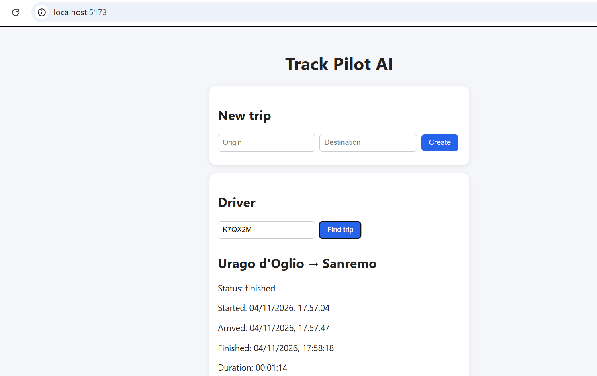

# Track Pilot AI

Trip tracking app for drivers.

A company creates a trip and the app generates a unique code. The driver enters the code, sees the trip, and records the start, arrival and finish times. The duration is calculated automatically.

## Features

- Company view: create trips from the browser
- Unique trip code generated automatically
- Driver view: find a trip by its code
- Status updates: start, arrive, finish, each with a timestamp
- Trip duration calculated automatically
- REST API built with Django REST framework
- Automated backend tests for the trip model and the driver API
- Live list of all trips for the company
- Colored status badges

## Getting started

    git clone https://github.com/alighabi/trackpilot-ai.git
    cd trackpilot-ai
    python -m venv venv
    .\venv\Scripts\Activate.ps1
    python -m pip install -r requirements.txt

Create a file named .env in the project folder with your own secret key:

    SECRET_KEY=your-secret-key
    DEBUG=True

Then create the database and start the server:

    python manage.py migrate
    python manage.py runserver

Then open a second terminal and start the frontend:

    cd frontend
    npm install
    npm run dev

Open http://localhost:5173 in your browser.

## Running the tests

    python manage.py test

## Environment variables

The backend reads these variables from the .env file in the project root:

- SECRET_KEY (required): Django secret key.
- DEBUG (optional): set to True for local development. If missing, it is False.
- ALLOWED_HOSTS (optional): comma-separated list of allowed host names, used in production.
- CORS_ALLOWED_ORIGINS (optional): comma-separated list of frontend URLs. Default: http://localhost:5173

The frontend reads one variable:

- VITE_API_URL (optional): base URL of the API. Default: http://127.0.0.1:8000